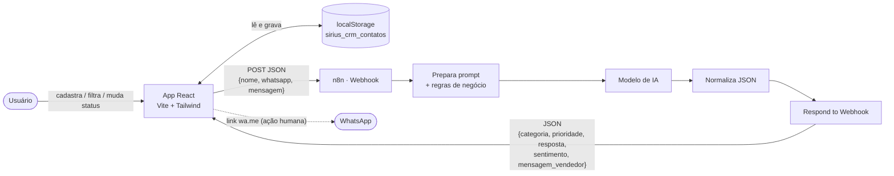
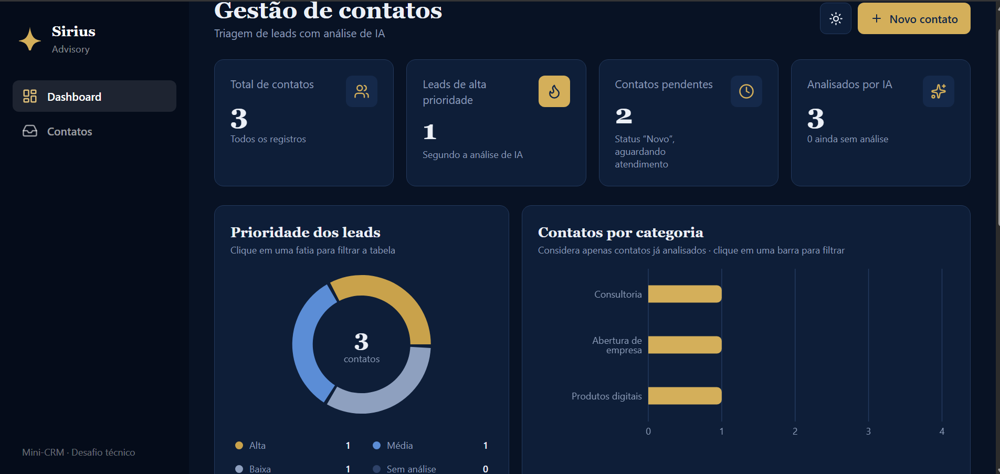
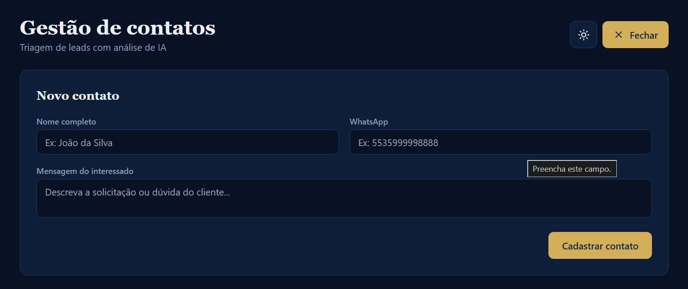
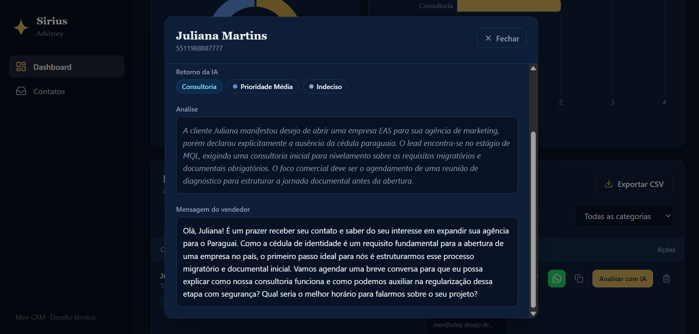

<div align="center">

# ✦ Sirius CRM — Mini-CRM Inteligente com IA e n8n

**Triagem de leads em segundos: cadastre o contato, clique em *Analisar com IA* e receba categoria, prioridade, sentimento e uma resposta comercial pronta para uso.**


*Desafio prático — Processo Seletivo 2026 · Sirius Advisory LLC*

[Visão geral](#-visão-geral) ·
[Funcionalidades](#-funcionalidades) ·
[Arquitetura](#-arquitetura) ·
[Instalação](#-como-executar) ·
[n8n](#-automação-com-n8n) ·
[Testes](#-testes-obrigatórios) ·
[Vídeo](#-demonstração)

</div>

---

## Visão geral

Uma consultoria internacional recebe, pelo WhatsApp e redes sociais, interessados em **abertura de empresas no Paraguai**, documentação, estruturação internacional, consultorias e produtos digitais. O desafio é não perder oportunidades comerciais enquanto a equipe entende a necessidade de cada pessoa.

O **Sirius CRM** resolve isso em duas camadas:

| Camada | O que faz | Tecnologia |
| --- | --- | --- |
| **Aplicativo web** | Cadastra contatos, lista, filtra, muda status, persiste os dados e exibe a análise | React + Vite + Tailwind |
| **Automação com IA** | Recebe o contato por Webhook, interpreta a mensagem com um modelo de IA e devolve um JSON estruturado | n8n + modelo de IA |

> **Nenhuma mensagem real é disparada.** O botão do WhatsApp apenas abre um link `wa.me` com o texto pré-preenchido, e o envio continua dependendo de um clique humano. Todos os dados do projeto são **fictícios**.

---

##  Funcionalidades

### Requisitos obrigatórios do desafio

- [x] Cadastro de contatos com **nome completo, WhatsApp e mensagem**
- [x] Lista/tabela de contatos
- [x] Alteração de status: **Novo → Em atendimento → Finalizado**
- [x] **Persistência** após atualizar a página (`localStorage`)
- [x] Botão **“Analisar com IA”** por contato, enviando nome, WhatsApp e mensagem ao Webhook do n8n
- [x] Exibição do retorno: **categoria, prioridade e resposta comercial sugerida**

### Extras que elevam o projeto

- **Dashboard** com 4 KPIs (total, alta prioridade, pendentes, analisados por IA)
- **Gráficos interativos** (Recharts): prioridade (rosca) e categoria (barras). Clicar neles **filtra a tabela**
- **Busca por nome** + filtros por prioridade e categoria, com botão “Limpar filtros”
- **Sentimento do cliente** retornado pela IA
- **Mensagem para o vendedor** (`mensagem_vendedor`) usada para abrir o WhatsApp já preenchido
- **Exportação CSV** compatível com Excel pt-BR (separador `;`, BOM UTF-8) e **protegida contra CSV/formula injection**
- **Tema claro/escuro** com tokens CSS, respeitando `prefers-color-scheme` e salvando a preferência
- Acessibilidade: `aria-label`, `aria-pressed`, `focus-visible`, textos `sr-only`
- Layout responsivo (sidebar recolhe em telas menores, tabela com rolagem horizontal)
- Exclusão de contatos

---

## Arquitetura



### Fluxo de uma análise, passo a passo

1. O usuário clica em **Analisar com IA** na linha do contato → o botão muda para *“Analisando...”* e fica desabilitado.
2. O front faz `POST http://localhost:5678/webhook/analisar-contato` com `{ nome, whatsapp, mensagem }`.
3. O **n8n** recebe, monta o prompt com as regras de negócio e consulta o modelo de IA.
4. O workflow devolve um **JSON padronizado** pelo nó *Respond to Webhook*.
5. O app valida cada campo (com valores padrão seguros), grava em `analiseIA` do contato e persiste no `localStorage`.
6. A UI exibe categoria, prioridade, sentimento e resposta sugerida; os KPIs e gráficos se atualizam automaticamente.

---

## Stack

| Tecnologia | Versão | Papel no projeto |
| --- | --- | --- |
| [React](https://react.dev) | ^19 | Interface declarativa, estado com hooks (`useState`, `useEffect`, `useMemo`) |
| [Vite](https://vite.dev) | ^8 | Dev server com HMR e build otimizado |
| [Tailwind CSS](https://tailwindcss.com) | ^3 | Estilização utilitária + design tokens via CSS variables |
| [Recharts](https://recharts.org) | ^3 | Gráficos de rosca e barras |
| [Lucide React](https://lucide.dev) | ^1 | Ícones SVG |
| [n8n](https://n8n.io) | — | Orquestração: Webhook → IA → resposta JSON |
| ESLint | ^10 | Qualidade de código (regras de hooks e React Refresh) |

---

## Como executar

### Pré-requisitos

- **Node.js** 20.19+ (LTS recomendado) e **npm**
- **n8n** (local via `npx n8n`, Docker ou n8n Cloud)
- Uma chave de um modelo de IA com **plano gratuito** (ex.: Gemini, Groq) **ou** um modelo local (ex.: Ollama)

### 1) Clonar e instalar

```bash
git clone https://github.com/AleCecilio/desafio-sirius-crm.git
cd desafio-sirius-crm
npm install
```

### 2) Subir o aplicativo

```bash
npm run dev
```

Abra o endereço exibido no terminal (por padrão `http://localhost:5173`).

### 3) Subir o n8n e importar o workflow

```bash
npx n8n          # abre em http://localhost:5678
```

1. No n8n: **Workflows → Import from File** → selecione `n8n/workflow-analisar-contato.json`.
2. Configure a **credencial do modelo de IA** no nó correspondente (a chave fica só no n8n, **nunca no repositório**).
3. Ative o workflow (**Active**) para que a URL de produção `/webhook/analisar-contato` responda.

> Sem o workflow ativo, o app continua 100% funcional para cadastro, status, filtros e exportação. Apenas o botão de IA exibirá um alerta de conexão.

### Scripts disponíveis

| Comando | Descrição |
| --- | --- |
| `npm run dev` | Servidor de desenvolvimento com HMR |
| `npm run build` | Gera o build de produção em `dist/` |
| `npm run preview` | Serve localmente o build de produção |
| `npm run lint` | Executa o ESLint |

---

## Automação com n8n

### Contrato da API

**Requisição** — `POST /webhook/analisar-contato` · `Content-Type: application/json`

```json
{
  "nome": "Carlos Silva",
  "whatsapp": "5535999990001",
  "mensagem": "Quero abrir uma empresa no Paraguai, mas não sei se é melhor EAS ou Unipersonal. Ainda não tenho cédula."
}
```

**Resposta esperada**

```json
{
  "categoria": "Consultoria",
  "prioridade": "Média",
  "resposta": "Olá, Carlos! Podemos entender melhor a sua situação e orientar os próximos passos em uma consultoria individual. Você já tem a cédula paraguaia ou ainda pretende iniciar esse processo?",
  "sentimento": "Neutro",
  "mensagem_vendedor": "Olá, Carlos! Aqui é da Sirius Advisory. Vi sua dúvida sobre EAS x Unipersonal e posso te ajudar a avaliar o melhor caminho. Podemos conversar?"
}
```

| Campo | Valores aceitos | Observação |
| --- | --- | --- |
| `categoria` | `Abertura de empresa` · `Consultoria` · `Produtos digitais` · `Outros serviços` | Se vier vazio, o app assume `Outros serviços` |
| `prioridade` | `Alta` · `Média` · `Baixa` | O app aceita `Media`/`media` (sem acento) e normaliza; se inválida, assume `Média` |
| `resposta` | texto | Sugestão comercial exibida na tabela |
| `sentimento` | texto curto (ex.: Positivo, Neutro, Dúvida) | Extra; padrão `Neutro` |
| `mensagem_vendedor` | texto | Extra; usada no link do WhatsApp (se ausente, usa `resposta`) |

### Regras de negócio aplicadas à IA

| Situação da mensagem | Categoria típica | Prioridade típica | Comportamento |
| --- | --- | --- | --- |
| Intenção clara de contratar | Abertura de empresa | **Alta** | Encaminhar ao atendimento comercial |
| Dúvidas sobre estrutura empresarial | Consultoria | **Média** | Sugerir consultoria e/ou fazer pergunta complementar |
| Quer aprender / pesquisando | Produtos digitais | **Baixa** | Sugerir conteúdo educativo ou produto digital |
| Faltam dados | — | — | Formular **pergunta complementar** |
| Qualquer caso | — | — | **Nunca** emitir conclusão jurídica, fiscal ou migratória definitiva |

### Desenho do workflow

```
[Webhook POST] → [Prepara prompt] → [Modelo de IA] → [Normaliza JSON] → [Respond to Webhook]
```

> Dica importante de CORS: no nó **Webhook** do n8n, em *Options → Allowed Origins (CORS)*, libere a origem do app (ex.: `http://localhost:5173`). Sem isso o navegador bloqueia a chamada.

---

## Testes obrigatórios

| # | Cenário | Mensagem fictícia | Comportamento esperado | Evidência |
| --- | --- | --- | --- | --- |
| 1 | Dúvidas | *“Quero abrir uma empresa no Paraguai, mas não sei se é melhor EAS ou Unipersonal. Ainda não tenho cédula.”* | Sugerir **consultoria** e/ou perguntas complementares | `apresentacao/evidencias/teste-1.png` |
| 2 | Pronto para contratar | *“Já tenho cédula paraguaia e quero contratar o serviço de abertura de EAS.”* | Identificar contratação e **encaminhar ao comercial** (prioridade Alta) | `apresentacao/evidencias/teste-2.png` |
| 3 | Pesquisando | *“Ainda não quero abrir empresa. Gostaria de aprender mais sobre negócios no Paraguai.”* | Indicar **conteúdo educativo / produto digital** | `apresentacao/evidencias/teste-3.png` |

Os três contatos já vêm pré-carregados no app (dados iniciais), prontos para o teste: **Carlos Silva**, **Mariana Costa** e **Roberto Alves**.

---

## Estrutura do projeto

```text
desafio-sirius-crm/
├── public/
│   ├── favicon.svg
│   └── icons.svg
├── src/
│   ├── App.jsx              # Todo o app: dados, helpers, componentes, estado e UI
│   ├── main.jsx             # Ponto de entrada (monta <App /> no #root)
│   └── index.css            # Diretivas Tailwind + tokens de tema (claro/escuro)
├── index.html
├── package.json
├── vite.config.js
├── tailwind.config.js
├── postcss.config.js
├── eslint.config.js
└── README.md
```

---

## Design

- **Identidade:** azul marinho `#122648` + dourado, inspirados na marca Sirius (estrela de quatro pontas no logotipo).
- **Tipografia:** *Manrope* (interface) e *Source Serif 4* (títulos e números), com *fallbacks* de sistema.
- **Tokens de tema:** variáveis CSS em formato `R G B` (ex.: `--surface: 255 255 255`) consumidas pelo Tailwind como `rgb(var(--surface) / <alpha-value>)`, o que permite opacidade (`bg-raised/60`) e troca de tema alterando uma única classe (`dark`) no `<html>`.

---

## Segurança e boas práticas

- **Sem segredos no front-end:** chaves de IA ficam apenas nas credenciais do n8n.
- **CSV injection mitigado:** células que começam com `=`, `+`, `-` ou `@` recebem um apóstrofo antes de exportar.
- **Links externos seguros:** `target="_blank"` sempre com `rel="noopener noreferrer"`.
- **Respostas defensivas:** todo campo vindo do n8n tem valor padrão; a prioridade é normalizada (acentos/caixa).
- **Dados fictícios:** nenhuma informação pessoal real é usada.
- **Guard-rails da IA:** o prompt proíbe parecer jurídico, fiscal ou migratório definitivo.

---

## Próximos passos (roadmap)

- [ ] Timeout e *retry* na chamada ao webhook
- [ ] Testes automatizados (Vitest + Testing Library)

---

### Capturas de tela

| Dashboard | Análise de IA |
|---|---|
|  | |  | 

---

## Autor

**Alessandro Moreira Cecilio**
Estudante de Sistemas de Informação — UEMG, Unidade Passos (MG)

> Projeto desenvolvido exclusivamente para fins avaliativos no processo seletivo da Sirius Advisory LLC (2026).
> Utiliza apenas dados fictícios e não dispara mensagens reais.
